# Release plan

30 services, 50 dependencies, 5 waves.

| | Release time |
|---|---|
| Sequential (one at a time) | 42m54s |
| Sync waves (each wave waits for its slowest service) | 9m19s |
| Critical-path scheduling, 6 parallel slots | **8m48s** |
| Lower bound for 6 slots (critical path vs total work / slots) | 8m09s |

**Critical path (8m09s):** elasticsearch -> config -> catalog -> invoicing

## Waves

| Wave | Services |
|---|---|
| 0 | elasticsearch, kafka, postgres, redis |
| 1 | audit, auth, config, feature-flags, partner-api, pricing, shipping |
| 2 | catalog, inventory, mobile-bff, notifications, payments, search, users, web-bff |
| 3 | cart, checkout, fraud, invoicing, loyalty, orders, recommendations, reporting, returns, reviews |
| 4 | admin-api |

**Redundant declared dependencies** (implied by others): catalog -> kafka, checkout -> postgres, inventory -> postgres, inventory -> redis, invoicing -> kafka, loyalty -> postgres, notifications -> postgres, orders -> auth, reviews -> redis, users -> elasticsearch

## Schedule (6 slots)

```mermaid
gantt
  dateFormat X
  axisFormat %M:%S
  section wave 0
  elasticsearch :crit, 0, 229
  kafka :0, 191
  postgres :0, 177
  redis :0, 230
  section wave 1
  audit :230, 304
  auth :230, 302
  config :crit, 229, 306
  feature-flags :230, 298
  partner-api :276, 320
  pricing :177, 276
  shipping :229, 319
  section wave 2
  catalog :crit, 306, 409
  inventory :298, 360
  mobile-bff :489, 526
  notifications :304, 396
  payments :302, 389
  search :320, 411
  users :319, 397
  web-bff :360, 414
  section wave 3
  cart :475, 520
  checkout :411, 487
  fraud :397, 458
  invoicing :crit, 409, 489
  loyalty :396, 439
  orders :439, 493
  recommendations :458, 504
  reporting :414, 475
  returns :389, 454
  reviews :487, 528
  section wave 4
  admin-api :454, 501
```

